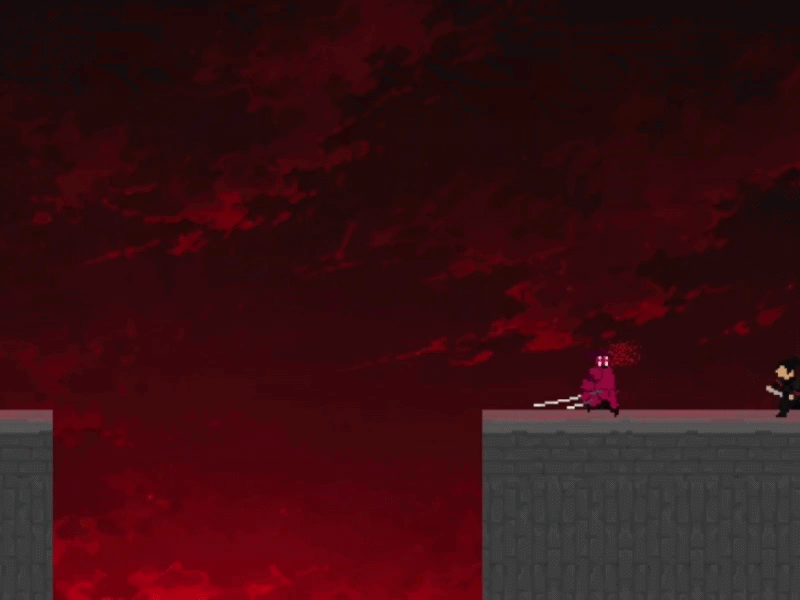
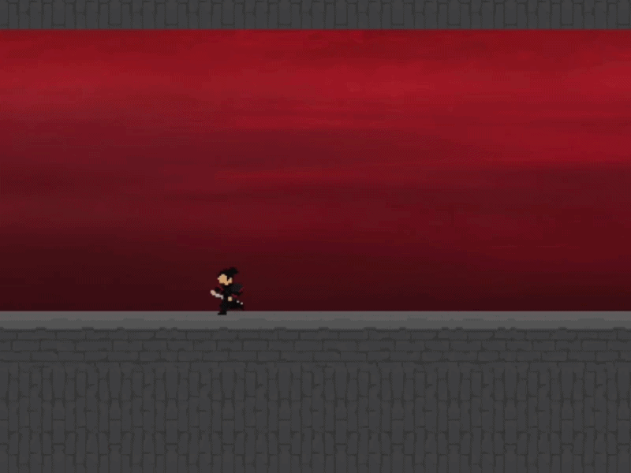

# Oni's Will Fall

**Action Platformer Prototype | GameMaker | GML**

An experimental action-platformer prototype created to turn an existing game concept into a playable, combat-focused experience. The primary goals are **responsive combat, readable visual feedback, and meaningful player-enemy interactions**.

## Project Information

| | |
| --- | --- |
| **Type** | Action Platformer Prototype |
| **Engine** | GameMaker |
| **Language** | GML |
| **Platform** | Windows |
| **Status** | Prototype / In Development |

## Gameplay Preview

### Combat System

### Parry & Hit Feedback

## Implemented Systems

**Combat and interaction**
- Three-hit combo combat system
- Parry system
- Double-parry interaction when the player and an enemy attack simultaneously
- Dash system
- Throwable objects
- Enemy combat interactions

**Combat readability and feedback**
- Hit stop
- Screen shake
- Blood particle effects
- Spark particle effects
- Visual enemy attack indicators

## Technical Challenges & Solutions

At the time, this was one of the most ambitious combat systems I had developed in GameMaker. The challenge was getting multiple mechanics—combos, parries, enemy attacks, and impact feedback—to interact correctly without compromising combat responsiveness or readability.

I refined the **timing and interaction between combat mechanics**, using feedback such as hit stop, screen shake, and particles to make successful hits and parries easier to recognize. The process improved my understanding of **combat timing, game feel, and gameplay state management**.

## Project Status

This is an **experimental prototype still in development**, not a finished commercial release.

## Portfolio

[See more of my work](https://richardportfolio-app.base44.app/)

**Developed by Richard Luis da Rosa.**
